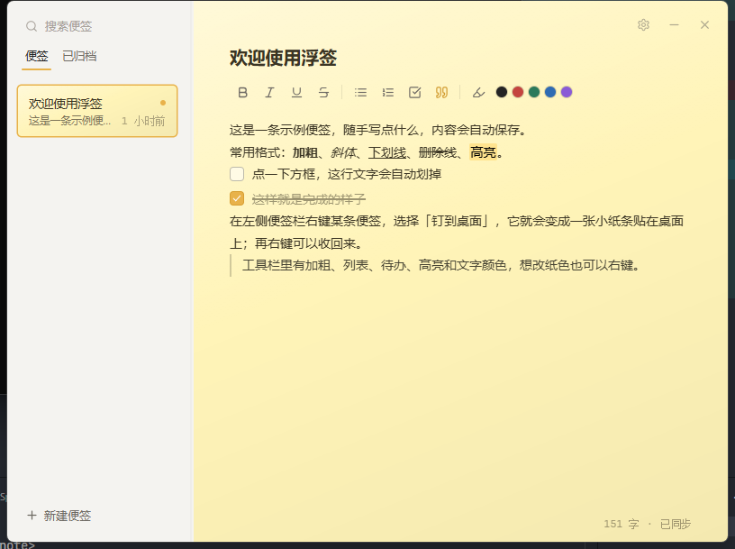
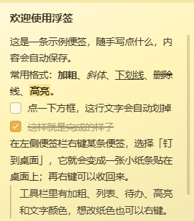

# 浮签 · FloatNote

贴在桌面上的便签，简单好用。

主窗口管理你所有的便签，任何一条都可以「钉到桌面」，变成一张真正贴在桌面上的小便签纸——它浮在壁纸和桌面图标之上，又不会被打开的程序挡住，切回桌面就能看到。

  
  &nbsp;
  

## 特色

- **彩色便签**：6 种纸色，每张便签都有自己的颜色，一眼分清。
- **富文本**：加粗、斜体、下划线、删除线、列表、引用、高亮、文字颜色，还能直接粘贴或拖入图片。
- **待办清单**：每项前面有勾选框，勾掉后文字自动划线变淡，专治忘事。
- **钉到桌面**：在便签上右键 →「钉到桌面」，它就变成桌面上的贴纸；右键再点一次即可收回。
- **多窗口同步**：主窗口和桌面上的小卡片编辑的是同一份内容，改哪边都会自动同步。
- **归档**：暂时不用的便签归档起来，列表保持清爽，随时可以找回来。
- **托盘常驻**：点关闭收进系统托盘（任务栏图标一起消失），托盘单击唤回；点最小化则是正常缩到任务栏。支持开机自启。
- **自动保存**：不用手动存，写下的每个字都会自动保存。

## 快速上手

1. 安装后启动，主窗口左侧就是便签列表，点底部「+ 新建便签」开始写。
2. 在左侧便签上**右键**，可以对它：钉到桌面 / 取消钉桌面、置顶、改颜色、重命名、复制、归档、删除。
3. 想找回归档的便签，点列表顶部的「已归档」。
4. 列表和编辑区之间那条竖线可以左右拖动，调整列表宽度，松手后自动记住。
5. 关闭窗口不会退出程序，托盘图标一直在；想彻底退出，右键托盘图标 →「退出」。

## 快捷键

| 快捷键 | 作用 |
| --- | --- |
| `Ctrl + N` | 新建便签 |
| `Ctrl + S` | 立即保存 |
| `Ctrl + Enter` | 插入 / 切换待办清单 |
| `Ctrl + B / I / U` | 加粗 / 斜体 / 下划线 |
| `Ctrl + ,` | 打开设置 |

## 常见问题

**数据存在哪？**
全部保存在本机 `%APPDATA%\com.niuz.floatnote\` 目录。想备份或迁移，直接复制这个文件夹即可。

**桌面便签为什么有时会闪一下？**
按 `Win + D` 显示桌面时，桌面会短暂盖住便签约 0.1 秒，随后它会自动回到桌面之上。

**图片是怎么存的？**
贴进便签的图片会直接编进便签内容一起保存（不额外建文件夹），所以单张别太大，建议 10MB 以内。

**小贴士**
- 桌面上的小便签可以拖动位置、右下角拖拽调整大小，位置会被记住，重启后还在原处。
- 怕误拖就点右上角的图钉按钮，锁定后位置和大小都不会再变。
- 纸色、字号、开机自启这些都在设置里（右上角齿轮，或按 `Ctrl + ,`）。
